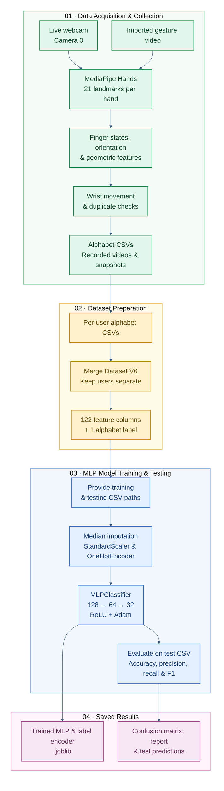
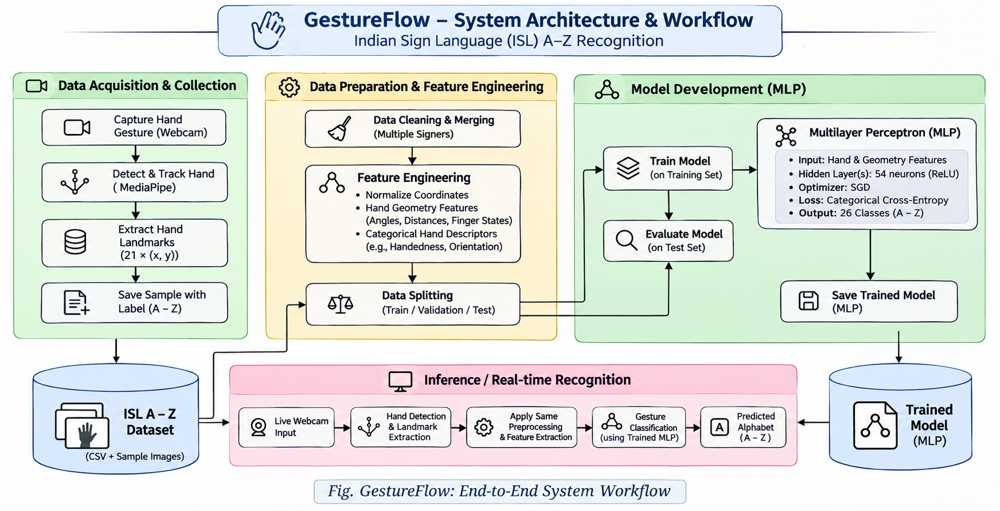
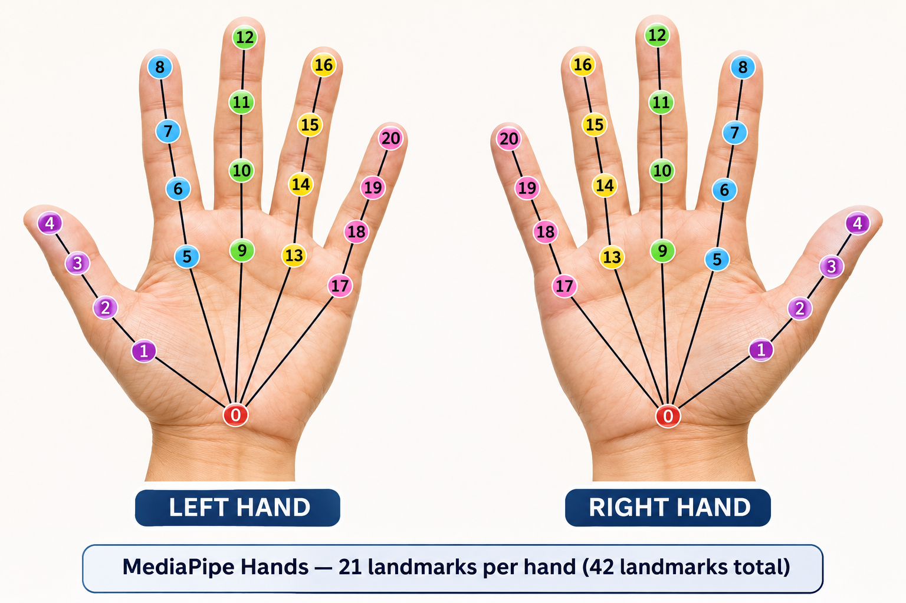

# GestureFlow

**GestureFlow** is a Python-based project for collecting hand-gesture data and training an **Indian Sign Language (ISL) alphabet classifier**. It uses **OpenCV** for webcam/video input, **MediaPipe Hands** for hand landmarks, **pandas** for CSV datasets, and a **scikit-learn Multi-Layer Perceptron (MLP)** for alphabet classification.

The recommended workflow in this repository is **Version 6 (V6)**:




### System architecture reference



### MediaPipe hand landmark reference



*The architecture image is a reference illustration; use the V6 model settings documented below for the current implementation.*

> **Project status:** The provided V6 scripts implement **data collection, dataset merging, offline model training and testing**. Webcam landmark detection is supported, but this repository does **not yet include a completed live alphabet-prediction application**. No real-world recognition accuracy is claimed in this README.

## Contents

1. [Requirements](#requirements)
2. [Installation (Windows)](#installation-windows)
3. [Camera selection](#camera-selection)
4. [Quick start: V6 workflow](#quick-start-v6-workflow)
5. [Collection rules and data storage](#collection-rules-and-data-storage)
6. [V6 CSV schema](#v6-csv-schema)
7. [Training model and outputs](#training-model-and-outputs)
8. [File guide](#file-guide)
9. [Troubleshooting](#troubleshooting)
10. [Data privacy and GitHub](#data-privacy-and-github)
11. [Limitations and reproducibility](#limitations-and-reproducibility)
12. [License](#license)

## Requirements

- **Windows 10/11**, with a working webcam for live collection. The current camera-opening code is Windows-oriented (`cv2.CAP_DSHOW`). Imported-video processing also requires supported video codecs.
- **64-bit Python 3.11** is recommended for the pinned dependency versions.
- A terminal (PowerShell or Windows Terminal).
- Enough disk space for recordings and snapshot images (one snapshot is saved per accepted sample).

All third-party dependencies are listed in [`requirements.txt`](requirements.txt):

| Package | Used for |
| --- | --- |
| `mediapipe` | Hand-landmark detection and tracking |
| `opencv-contrib-python` | Webcam, video, drawing, video writing and screenshots |
| `numpy` | Numeric data processing |
| `pandas` | CSV input/output and dataset merging |
| `scikit-learn` | Preprocessing, MLP classification and metrics |
| `matplotlib` / `seaborn` | Confusion-matrix visualization |
| `joblib` | Saving the trained model and label encoder |

The collection script's GUI uses **Tkinter**, which is normally bundled with the standard Windows Python installer. Python standard-library modules (`csv`, `pathlib`, `os`, `math`, etc.) do not require separate installation. The code uses the legacy **`mp.solutions`** API, so do not casually upgrade MediaPipe past the version pinned in `requirements.txt` without checking compatibility.

## Installation (Windows)

### 1. Get the repository

Clone your team's GitHub repository (replace the placeholder URL):

```powershell
git clone <YOUR-GESTUREFLOW-REPOSITORY-URL>
cd GestureFlow
```

If you already downloaded or cloned it, simply open PowerShell in that folder. Example for an existing local checkout:

```powershell
cd L:\Github\GestureFlow
```

### 2. Check Python and create a virtual environment

```powershell
py -3.11 --version
py -3.11 -m venv .venv
```

If the first command fails, install **Python 3.11 (64-bit)** and rerun it. Keep `.venv/` locally; it should **not** be pushed to GitHub.

### 3. Activate and install packages

```powershell
.\.venv\Scripts\Activate.ps1
python -m pip install --upgrade pip
python -m pip install -r requirements.txt
```

A successful activation usually changes the prompt to `(.venv) PS ...>`.

**PowerShell activation blocked?** No need to change system execution policies. Run the environment's Python executable directly:

```powershell
.\.venv\Scripts\python.exe -m pip install -r requirements.txt
.\.venv\Scripts\python.exe collection_data_v6.py
```

### 4. Check the installation

```powershell
python -c "import cv2, mediapipe as mp, pandas, sklearn; print('Dependencies OK'); print('MediaPipe:', mp.__version__)"
```

Run the following optional webcam smoke test before live collection:

```powershell
python camera_test.py
```

Press **Q** to close the camera test. The updated `collection_data_v6.py` and `camera_test.py` both use **camera index `0`** (the usual built-in/default webcam). If you have multiple cameras or a virtual camera, see [Camera selection](#camera-selection) below.

## Camera selection

The latest local V6 collector is configured to open **camera index `0`**. In `collection_data_v6.py`, the `open_camera()` function should use index `0` for both the Windows DirectShow attempt and its fallback:

```python
camera = cv2.VideoCapture(0, cv2.CAP_DSHOW)
if not camera.isOpened():
    camera.release()
    camera = cv2.VideoCapture(0)
```

Index `0` usually selects the primary camera; other devices may use `1`, `2`, etc. Keep the index consistent in both calls when changing cameras. The collector uses a requested camera resolution of **640 × 480**. After changing the file, **save and commit the updated `collection_data_v6.py`** so GitHub users receive the same camera configuration described here.

## Quick start: V6 workflow

The three scripts are designed to run **in this order**. Keep your terminal in the repository root and your virtual environment activated.

### Step 1 — Collect data with `collection_data_v6.py`

```powershell
python collection_data_v6.py
```

The program:

1. Prints the full forms of V6 CSV feature abbreviations **once at startup**.
2. Asks for your **username once per program run** (for example, `Sayandeep`). It reuses an existing folder of the same name.
3. Asks which **English alphabet (A–Z)** to collect. Type `exit` to quit.
4. Displays a source selection dropdown: **Live data (camera)** or **Old data (video file)**. If the GUI is unavailable, a terminal selection is offered.
5. Saves accepted samples to `<Username>/<Username>_Dataset/<Letter>.csv` and snapshots to `<Username>/<Username>_Snapshots/<Letter>/`.
6. Returns to the **alphabet prompt** after the session ends. The username is not asked again until the program is restarted.

**Live data mode:** The webcam opens, there is a **3-second countdown**, and a video of the session is saved from the beginning, including frames that are not accepted as samples. Press **Q** or **Esc** in the camera window to stop. It also ends automatically after the letter reaches 100 saved samples.

**Old data mode:** A file picker lets you select an existing video. The program copies the video into the user folder under a unique name and extracts samples without opening a live camera preview. Processing ends when the video ends or the letter reaches 100 saved samples.

A session may save **fewer than 100** samples if not enough frames meet the collection rules. Continue collecting that letter in another session until it reaches the cap.

### Step 2 — Merge users' CSVs with `merge_dataset_v6.py`

```powershell
python merge_dataset_v6.py
```

Example terminal interaction:

```text
How many user datasets do you want to merge? 2
Enter V6 USER folder path for user 1/2: L:\Github\GestureFlow\Sayandeep
Enter V6 USER folder path for user 2/2: L:\Github\GestureFlow\Abhirup
```

- Provide a **user folder** (`...\Sayandeep`), or its nested **`Sayandeep_Dataset`** folder. **Do not** provide an individual `A.csv` path.
- The merger reads all available **`A.csv` through `Z.csv`** files for each user. It does not require all 26 alphabets; empty CSVs are skipped.
- Each user's data is merged **separately**, and the letter from each source filename is written to a final **`label`** column.
- No timestamp column is added. Each merged file has **122 features + 1 label = 123 columns**.
- A new output folder is created on each successful run: `Merged_Dataset_Version_1`, `Merged_Dataset_Version_2`, etc. Older version folders are preserved.

Example output:

```text
Merged_Dataset_Version_1/
├── Marched Sayandeep.csv
└── Marched Abhirup.csv
```

The spelling **`Marched Username.csv`** is intentional: it is the filename convention used by these scripts.

### Step 3 — Train and test with `model_train_test_v6.py`

```powershell
python model_train_test_v6.py
```

Provide paths to **merged CSVs**, not individual alphabet CSVs:

```text
Enter TRAINING CSV path: L:\Github\GestureFlow\Merged_Dataset_Version_1\Marched Sayandeep.csv
Enter TESTING CSV path : L:\Github\GestureFlow\Merged_Dataset_Version_1\Marched Abhirup.csv
```

The model is fitted **only on the training data**, then evaluated against the testing data. For a better measure of how well the model works on unseen people, use a **different person's data for testing** whenever possible.

**Important rules:**

- Training must contain **at least two different alphabet labels**.
- Every alphabet appearing in the testing CSV must also appear in the training CSV.
- Train and test must both have the **same exact V6 column schema and order**.
- Using the **same file for training and testing** is allowed by the script but triggers a warning; it is **not a valid independent holdout evaluation**.

## Collection rules and data storage

### One-hand vs. two-hand letters

| Hand requirement | Letters |
| --- | --- |
| **Exactly one hand** | `C`, `O`, `I`, `L`, `U`, `V` |
| **Both hands simultaneously** | Every other alphabet from `A` to `Z` |

For a one-hand letter, the script keeps the same detected left/right hand across collection sessions for that letter and writes **zero** for the unused hand's feature columns and all cross-hand feature columns.

### Sampling and stopping rules

- **Maximum 100 total accepted samples per alphabet**, including samples saved during previous sessions. Existing valid CSVs are appended to, not replaced.
- A sample is eligible only after the required wrist(s) move by **at least `0.025` on both normalized X and normalized Y axes** compared with the last accepted reference pose (or an initial valid pose). Both wrists must qualify for two-hand letters.
- At a 640×480 camera setting, the `0.025` threshold is approximately **16 horizontal pixels and 12 vertical pixels**.
- The code compares hand landmark coordinates against previously saved samples and rejects near-duplicates using a normalized landmark RMS threshold of `0.012`.
- One **PNG snapshot per accepted sample** is saved, with hand landmarks drawn. Video recording continues even when frames are rejected. The snapshot filename corresponds to the accepted sample number.
- These checks **reduce static or repeated examples**, but cannot mathematically guarantee that every accepted sign is unique or labelled correctly.

The threshold constants are near the top of `collection_data_v6.py` (`X_VARIATION_THRESHOLD`, `Y_VARIATION_THRESHOLD`, `MAX_ROWS`, `DUPLICATE_RMS_THRESHOLD`). Avoid modifying them unless you understand the effect on data consistency.

### Where files are saved

For example, after collecting `A` and `C` under username `Sayandeep`:

```text
GestureFlow/
├── collection_data_v6.py
├── merge_dataset_v6.py
├── model_train_test_v6.py
├── requirements.txt
├── README.md
│
├── Sayandeep/
│   ├── Sayandeep_A_video.mp4         # may be AVI, depending on codec availability
│   ├── Sayandeep_A_video_02.mp4      # a later session will not overwrite the first
│   ├── Sayandeep_C_video.mp4
│   ├── Sayandeep_Dataset/
│   │   ├── A.csv                    # at most 100 rows + CSV header
│   │   └── C.csv
│   └── Sayandeep_Snapshots/
│       ├── A/
│       │   ├── A_0001.png
│       │   ├── A_0002.png
│       │   └── ...
│       └── C/
│           └── C_0001.png
│
├── Merged_Dataset_Version_1/
│   ├── Marched Sayandeep.csv
│   └── Marched Abhirup.csv
│
└── MLP_train(Sayandeep)_test(Abhirup)_result/
    ├── isl_mlp_model.joblib
    ├── label_encoder.joblib
    ├── confusion_matrix.png
    ├── classification_report.txt
    ├── test_predictions.csv
    └── model_configuration.txt
```

Paths are **relative to the directory containing the script**, not necessarily the directory from which you launched PowerShell. If an existing recording or result folder has the same name, the scripts choose a numbered name rather than overwriting it.

## V6 CSV schema

### Raw alphabet CSV: **122 columns, no timestamp**

The collector uses the following **exact order**:

| Order | Group | Columns |
| --- | --- | --- |
| 1 | Left-hand 21 landmark coordinates (42 values) | `Lx0`, `Ly0`, ... `Lx20`, `Ly20` |
| 2 | Left-hand geometric features (6 values) | `TILX`, `TILY`, `LD45x`, `LD45y`, `LD46X`, `LD46Y` |
| 3 | Left finger states and hand state (7 values) | `LT`, `LI`, `LM`, `LR`, `LL`, `Left_Orientation`, `Left_Hand_Position` |
| 4 | Right-hand 21 landmark coordinates (42 values) | `Rx0`, `Ry0`, ... `Rx20`, `Ry20` |
| 5 | Right-hand geometric features (6 values) | `TIRX`, `TIRY`, `RD45x`, `RD45y`, `RD46X`, `RD46Y` |
| 6 | Right finger states and hand state (7 values) | `RT`, `RI`, `RM`, `RR`, `RL`, `Right_Orientation`, `Right_Hand_Position` |
| 7 | Wrist-to-wrist offsets (2 values) | `wx`, `wy` |
| 8 | Between-hand fingertip offsets (10 values) | `DBTTX`, `DBTTY`, `DBIIx`, `DBIIy`, `DBMMX`, `DBMMY`, `DBRRX`, `DBRRY`, `DBLLX`, `DBLLY` |

The X/Y components are **signed coordinate differences in MediaPipe's normalized image coordinates**, **not Euclidean distances**.

| Abbreviation | Meaning | Formula per axis |
| --- | --- | --- |
| `TIL` / `TIR` | Thumb tip → index fingertip, left / right | Landmark `8 − 4` on that hand |
| `LD45` / `RD45` | Landmark 4 → landmark 5, left / right | Landmark `5 − 4` on that hand |
| `LD46` / `RD46` | Landmark 4 → landmark 6, left / right | Landmark `6 − 4` on that hand |
| `wx`, `wy` | Wrist-to-wrist offset | Right wrist `0` − left wrist `0` |
| `DBTT` | Between thumb tips | Right tip `4` − left tip `4` |
| `DBII` | Between index fingertips | Right tip `8` − left tip `8` |
| `DBMM` | Between middle fingertips | Right tip `12` − left tip `12` |
| `DBRR` | Between ring fingertips | Right tip `16` − left tip `16` |
| `DBLL` | Between little fingertips | Right tip `20` − left tip `20` |

All of the `DB*` and `wx`/`wy` features are **zero when a hand is missing**. The four old `LDIIx`, `LDIIy`, `RDIIX`, `RDIIY` fields are **not present in V6**.

**Categorical values:** Individual finger states use `0 = closed` and `1 = open`; hand positions use `0 = all closed`, `1 = all open`, `2 = mixed`; orientations use `F = front`, `B = back`, `S = side`, according to the project's landmark-based rules.

### Merged CSV: **123 columns**

`merge_dataset_v6.py` preserves the 122 original feature columns in order and adds **`label` as the final column**, containing the alphabet from the source filename. It does **not** append a timestamp.

**Do not mix V6 raw/merged CSVs with V1–V4 formats.** The V6 merger and trainer intentionally reject incorrect column counts, names or ordering. Converting an older dataset requires a deliberate, verified transformation; simply renaming columns is not sufficient if the old features had different formulas.

## Training model and outputs

`model_train_test_v6.py` uses scikit-learn's **`MLPClassifier`**, with the original Version 1 hyperparameters:

| Setting | Value |
| --- | --- |
| Hidden layers | `(128, 64, 32)` |
| Activation | `relu` |
| Optimizer | `adam` |
| L2 regularization (`alpha`) | `0.0001` |
| Batch size | `32` |
| Learning rate | `0.001` |
| Maximum iterations | `500` |
| Random state | `42` |
| Early stopping | `False` |

The model processes **108 numerical features** using **median imputation + `StandardScaler`**, and **14 categorical features** using `OneHotEncoder(handle_unknown="ignore")`. A `LabelEncoder` maps alphabet labels to target classes. All preprocessing transformers are fitted **on training data only**.

Each run writes a new `MLP_train(<TrainUser>)_test(<TestUser>)_result/` folder; repeated runs receive `_1`, `_2`, etc. The output contains:

| File | Purpose |
| --- | --- |
| `isl_mlp_model.joblib` | Trained preprocessing-and-MLP pipeline |
| `label_encoder.joblib` | Alphabet label-to-class mapping |
| `confusion_matrix.png` | Actual vs predicted labels |
| `classification_report.txt` | Accuracy, precision, recall and F1 metrics |
| `test_predictions.csv` | Testing rows with appended `predicted_label` |
| `model_configuration.txt` | Hyperparameters, user info, column counts and classes |

> **Evaluation guidance:** The reported accuracy is specific to the supplied test dataset. It is not a validated accuracy estimate for all signers, cameras, lighting conditions or real-time use. Do not load `.joblib` files from untrusted sources, because Python pickle-based model files can execute code while loading.

## File guide

| File | Description |
| --- | --- |
| **`collection_data_v6.py`** | **Current collector**: camera/imported-video hand features, CSVs, videos and snapshots |
| **`merge_dataset_v6.py`** | **Current merger**: separate user CSVs and `label` column |
| **`model_train_test_v6.py`** | **Current trainer**: MLP model and evaluation artifacts |
| `requirements.txt` | Pinned Python dependencies |
| `camera_test.py` | Basic webcam test (uses camera 0) |
| `handland_marks_test.py` | MediaPipe landmark visualizer |
| `gf_pipeline1.py`, `Initial_pipeline.py` | Earlier webcam/hand status prototype scripts |
| `collection_data_v1.py`–`collection_data_v4.py` | Historical collection implementations |
| `merge_dataset_v1.py`–`merge_dataset_v4.py`, `merge_csv.py` | Earlier merging implementations, **not recommended for V6 data** |
| `model_train_test_v1.py`, `model_train_test_v2.py`, `model_train_test_v4.py`, `train_test_mlp.py` | Earlier MLP training/evaluation implementations |
| `.gitignore` | Git exclusion configuration (review privacy exclusions below) |
| `LICENSE` | MIT license |

The uploaded project snapshot did not contain a `collection_data_v5.py`, `merge_dataset_v5.py`, or `model_train_test_v5.py`; V6 is the latest provided workflow. Older versions are retained for development history and may use incompatible CSV layouts.

## Troubleshooting

**`No module named cv2` / `mediapipe` / `sklearn`**  
Confirm you installed packages in the same Python interpreter used to run the script:

```powershell
.\.venv\Scripts\python.exe -m pip install -r requirements.txt
.\.venv\Scripts\python.exe collection_data_v6.py
```

**V6 says `Cannot open camera`**  
The updated collector uses **camera index `0`** in both `cv2.VideoCapture(0, cv2.CAP_DSHOW)` and fallback `cv2.VideoCapture(0)`. Check whether the webcam works with `python camera_test.py`, close Teams, Zoom, or other camera-using apps, and check Windows camera permissions. If you use an external/virtual camera and index `0` selects the wrong device, try its actual device index in **both** calls in `open_camera()` (see [Camera selection](#camera-selection)).

**Tkinter dropdown / file picker does not appear**  
Try `python -m tkinter`. If Tkinter is unavailable, the collector falls back to terminal input for the input mode and a typed video file path for old-video processing.

**Few or no samples are accepted**  
Ensure the required hand count is visible and correctly detected, move the required wrist(s) along **both X and Y**, keep the whole hand within the camera frame, and use adequate lighting. When importing an old video, there is no 3-second delay, but the same movement and near-duplicate rules still apply. A static hand may produce zero saved samples.

**`100-sample cap already reached`**  
That letter already contains 100 or more saved samples. The collection script will not collect more for that letter. Do not delete a CSV without first backing up the corresponding snapshots and videos.

**`Existing CSV has a different column schema` / `Unsupported columns`**  
Use **Collection V6** alphabet CSVs with exactly 122 columns, and **Merge V6** outputs with 123 columns. An old CSV with different fields cannot be appended to or merged as-is. Keep copies of older datasets separate.

**Train/test has unseen alphabet labels**  
Every test label must be represented in training. Include that alphabet in the training CSV, or choose another appropriate test dataset.

**`FileNotFoundError` when entering a CSV path**  
Copy the full path from File Explorer. You can paste paths with spaces, including `Marched Sayandeep.csv`; the scripts strip wrapping quotation marks.

**A V6 script prints “Version 4”**  
The currently provided `merge_dataset_v6.py` and `model_train_test_v6.py` have **stale display/report text** that says “Version 4”. Their actual feature validation uses the **V6 122/123-column schema**; the text is a known cosmetic inconsistency in the reviewed files.

## Data privacy and GitHub

Collection videos and snapshots can contain **identifiable people and surroundings**. Only collect or share material with appropriate consent.

**Important:** The `.gitignore` in the provided folder already ignores `.venv/`, `venv/`, `.env` and Python caches, but it **does not currently ignore the user-specific datasets, saved videos, merged datasets or MLP result folders**. Before pushing, decide explicitly whether any of those should be public.

To keep generated data and trained artifacts local, you can **add** the following to `.gitignore`:

```gitignore
# Optional: locally collected gesture data and recordings
/*/*_Dataset/
/*/*_Snapshots/
/*/*_video*.*
/Merged_Dataset_Version_*/
/MLP_train*_result*/
```

These rules prevent **new, untracked** files from being staged by `git add .`, but do not automatically untrack files already committed. Review `git status` and `git ls-files` before pushing, and consider Git history and consent if recordings were previously published.

Never push `.venv/`, passwords, private API tokens or unapproved personal recordings. Keep a backup of datasets and model outputs before changing or replacing a collection schema.

## Limitations and reproducibility

- The V6 scripts target **static alphabet-labelled samples** collected from video frames; they do not implement time-series sign/word recognition.
- The collector assumes left/right handedness and orientation outputs from MediaPipe and uses heuristic finger-state thresholds. These may require testing under different conditions.
- Sample collection deliberately favors wrist movement and rejects near-identical frames; this affects the distribution of the saved dataset.
- A single person's data can be useful for development, but **cross-user testing** gives a more meaningful check of generalization.
- The code provides offline training/testing, but no live UI that loads `isl_mlp_model.joblib` and produces alphabet predictions has been provided.
- Dependency versions are pinned for reproducibility, but results can still vary with hardware, videos, data quality and environments.

## License

Distributed under the **MIT License**. See [`LICENSE`](LICENSE) for the complete terms and copyright notice.
